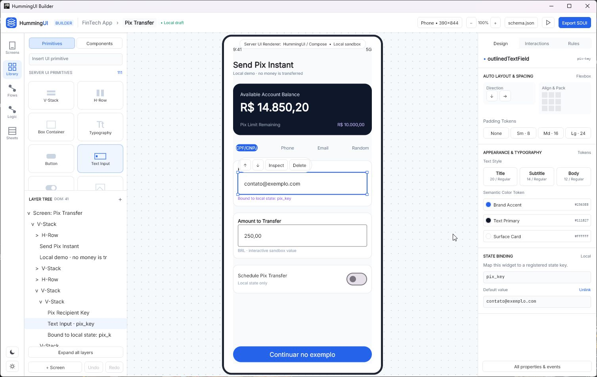
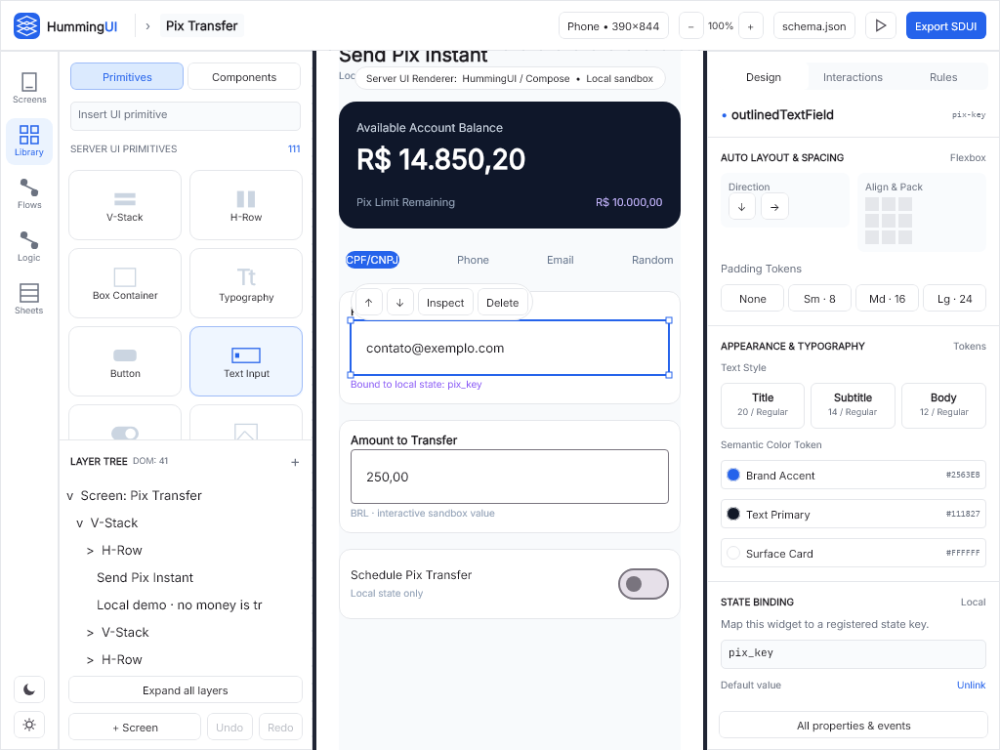
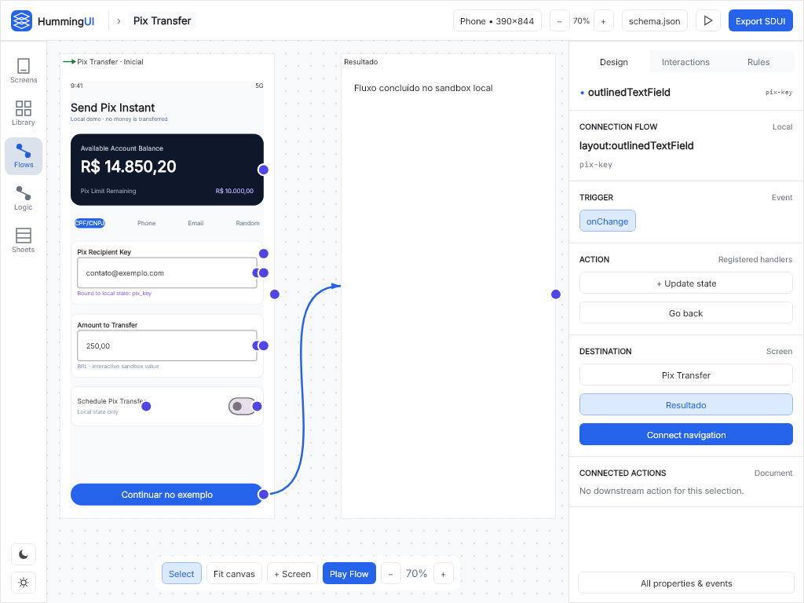
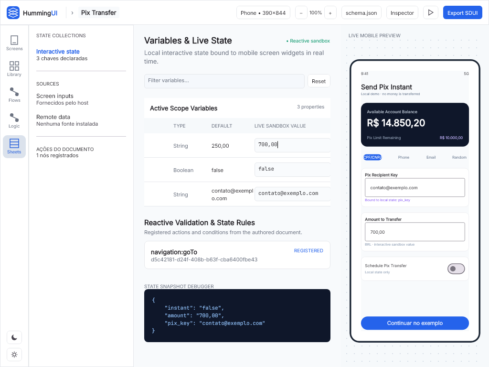
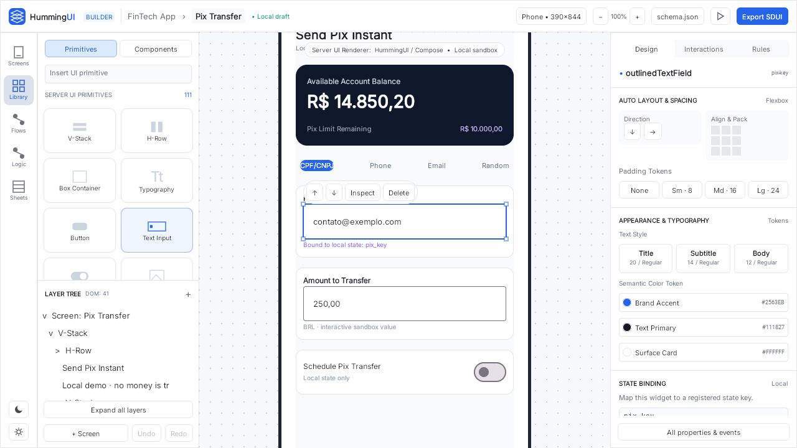
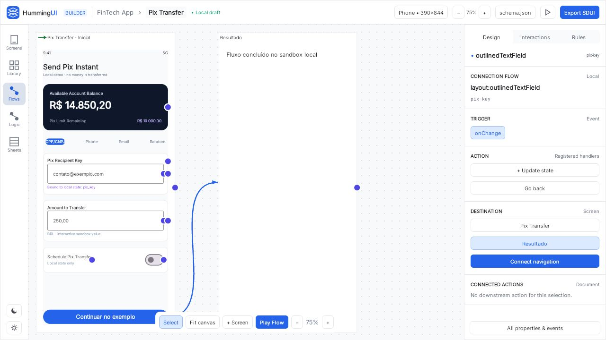
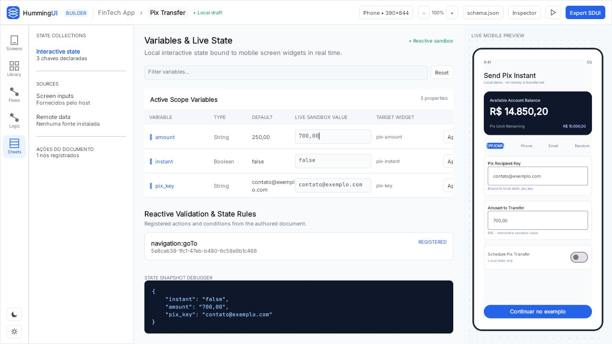

# HummingUI Builder

App oficial de autoria Compose Multiplatform, inspirado no [HummingUI Canvas Studio no Stitch](https://stitch.withgoogle.com/projects/2399743288518543485). UI compartilhada em `humming-studio-ui`; o sample continua sendo um consumidor independente. O runtime e os formatos autorais existentes são preservados.

No PowerShell, na raiz do repositório:

```powershell
.\gradlew.bat :HummingUI-Builder:run
.\gradlew.bat :HummingUI-Builder:wasmJsBrowserDevelopmentRun
```

Screens e Library editam o documento; Flows usa as conexões reais do editor. Logic e Sheets abrem o sandbox de estado da tela selecionada e os nós de ação declarados. O exemplo Pix é local e não efetua transações. Play inicia a jornada SDUI real. `schema.json` e `Export SDUI` abrem validação/exportação.

Clique na marca **HummingUI** no canto superior esquerdo para Novo/Abrir/Salvar projeto, renomear, desfazer/refazer e acessar o Studio avançado. Salvar/Abrir preservam o envelope `AppProject` existente. Salve o projeto antes de fechar; não há autosave. A barra contextual sobre a seleção permite reordenar, inspecionar e remover; o Inspector compacto aplica propriedades suportadas pelo schema, incluindo padding, alinhamento, cores e bindings. `All properties & events` abre a edição completa.

O State Manager separa defaults autorais dos valores da sessão. Editar o valor live atualiza o preview e o JSON; Apply altera o default do documento e participa do histórico; Reset restaura os defaults. A tabela possui rolagem horizontal quando necessário. Em janelas menores que 1500 dp, o botão Inspector abre o painel em diálogo para preservar espaço.

Tema no rodapé configura o Design System do projeto; Light/Dark altera a aparência do editor. Inter e JetBrains Mono são incorporadas, com licenças em `humming-studio-ui/licenses`. Publicação, colaboração e deploy dependem das capacidades do host. O browser baixa arquivos, sem comprovar sua gravação. A fidelidade visual e qualificação por plataforma são registradas em [estado atual](../docs/current-state.md), e a direção visual está em [DESIGN.md](DESIGN.md). Os HTMLs originais e a auditoria de suas funcionalidades estão na [referência Stitch](../docs/stitch-reference.md); as evoluções têm escopo e aceite no [plano](../docs/development-plan.md).

Capturas reais dos testes Compose/JVM, em área de 1024×768; a janela desktop foi observada separadamente. O cabeçalho compacto conserva uma linha nessa largura.









O bundle Wasm também foi executado em navegador, com edição reativa de estado e navegação até a segunda tela. Essas observações não qualificam interação por toque nem persistência de downloads.






