# App demonstrador e catálogo oficial HummingUI

Este app reúne **111 componentes visuais**, os **16 handlers de ação** existentes e os percursos de autoria, execução e serviços SDUI. Os exemplos são documentos reais: JSON SDUI → importação autoral → validação → compilação → provider registrado → renderer. O Studio abre o mesmo documento que originou o preview. Não há uma galeria paralela desenhada diretamente em Compose para substituir os handlers.

## Início rápido

Execute os comandos abaixo **na raiz do repositório**, em PowerShell 7, com JDK 25 configurado. Use o wrapper versionado, sem instalar outra versão de Gradle.

```powershell
.\gradlew.bat :sample:composeApp:tasks --all
.\gradlew.bat :sample:composeApp:wasmJsBrowserDevelopmentRun
```

Abra [catálogo local](http://127.0.0.1:8080/). A primeira compilação/linkedição Wasm pode demorar. A porta é a informada pelo dev server; se 8080 estiver ocupada, encerre a instância anterior no terminal antes de iniciar outra.

Para o desktop:

```powershell
.\gradlew.bat :sample:composeApp:run --args=--catalog
```

O catálogo local não exige conta, backend, Docker ou credencial. Instalações do SDK Android exigidas pela configuração Gradle devem estar configuradas no ambiente/local.properties; não versione caminhos de SDK. Os builds distinguem toolchain JVM 25 de bytecode Android Java 17. Android usa compile/target SDK 37 e min SDK 24.

## Criador de apps

No catálogo, abra **Criador de apps**, ou execute diretamente:

```powershell
.\gradlew.bat :sample:composeApp:run --args=--builder
```

No dev server Wasm, use [criador local](http://127.0.0.1:8080/?builder). Se a porta for outra, mantenha `?builder`. O criador usa o mesmo runtime SDUI e não exige servidor para criar, testar ou exportar projetos.

Siga **Novo → Estrutura → Design → Ações → Testar → Exportar**. Escolha um modelo, crie telas, insira componentes, edite propriedades e conecte eventos de navegação/retorno. A paleta usa os 111 componentes existentes, incluindo composições que preservam os slots e pais exigidos. **Studio avançado** abre o mesmo documento. Veja [formato do projeto e limites](../docs/app-builder.md).

**Salvar projeto completo** gera o arquivo reeditável; **Exportar jornada SDUI** gera o pacote para um host HummingUI compatível. Preserve o download e reabra para confirmar a recuperação. Não há autosave. O pacote não gera APK/IPA nem publica serviços. O editor de três painéis é destinado a janelas largas; em larguras menores, o Inspector é acessível pelo Studio avançado.

As quatro capturas abaixo foram produzidas pelo fluxo automatizado Compose/JVM, com arquivo real de projeto e pacote compilado. A quinta é Wasm no navegador, após navegar para a segunda tela; o retorno também foi observado.

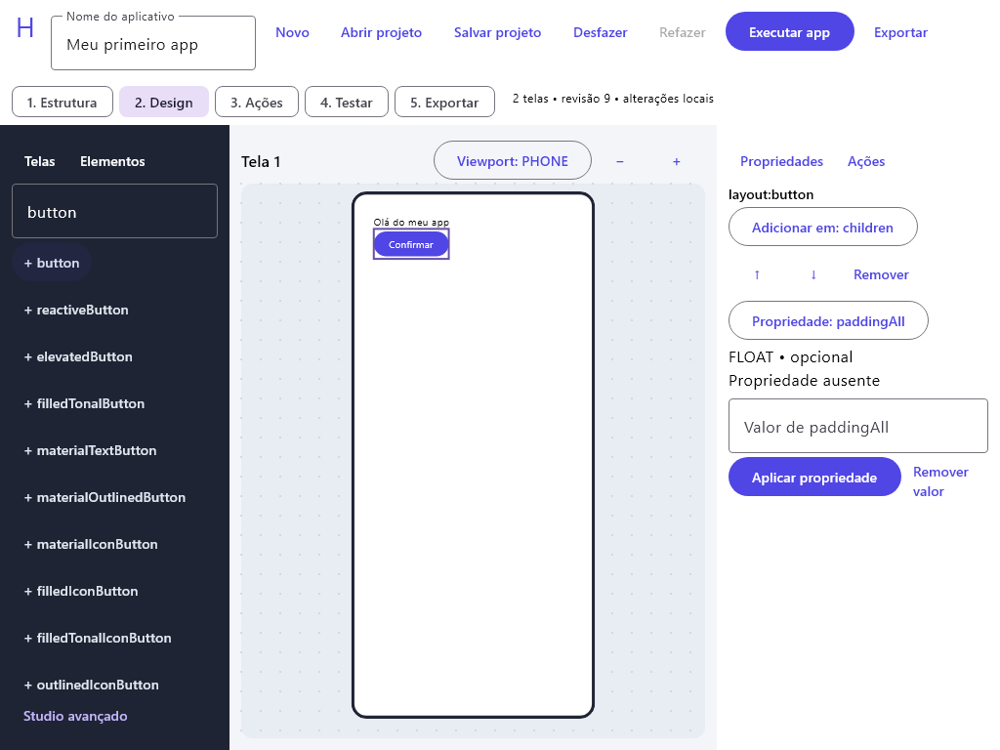

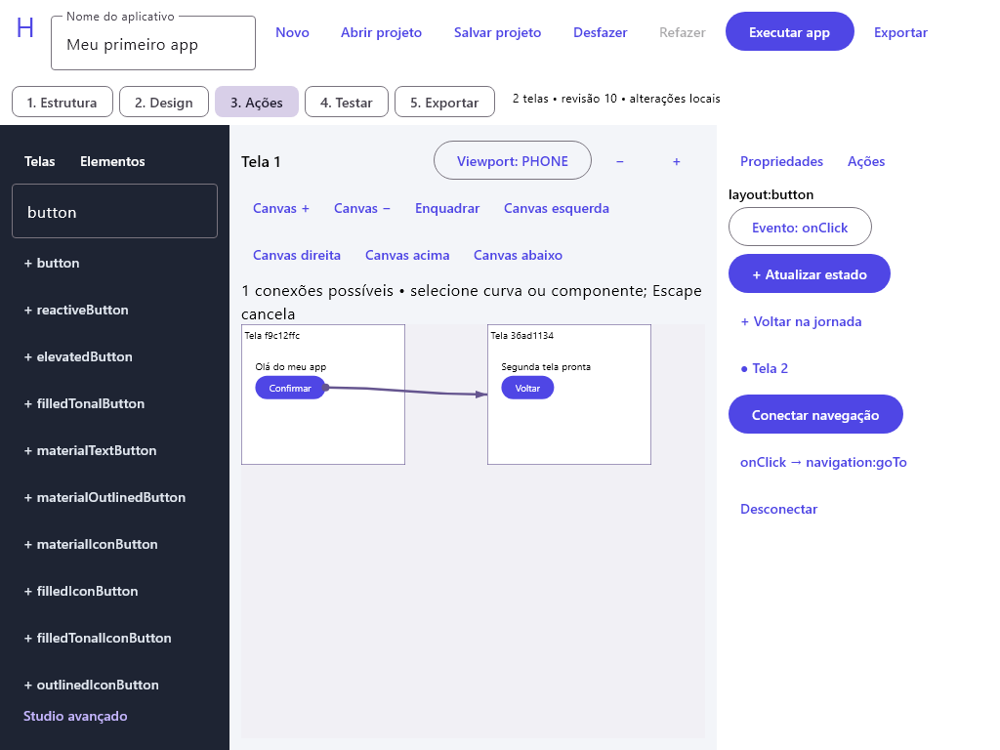

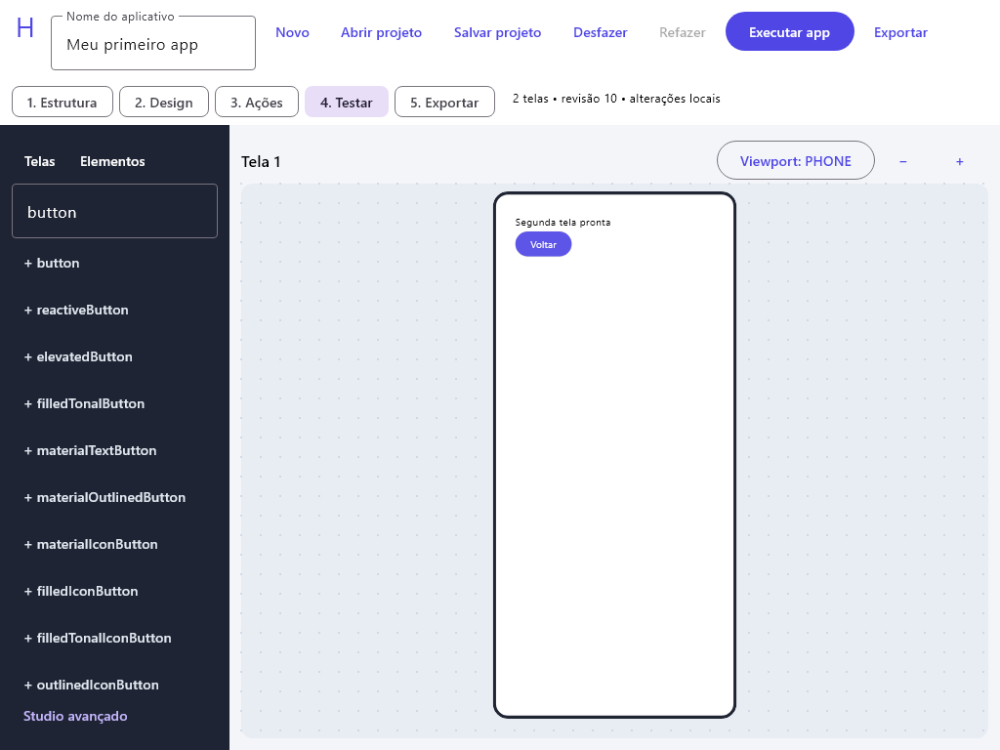

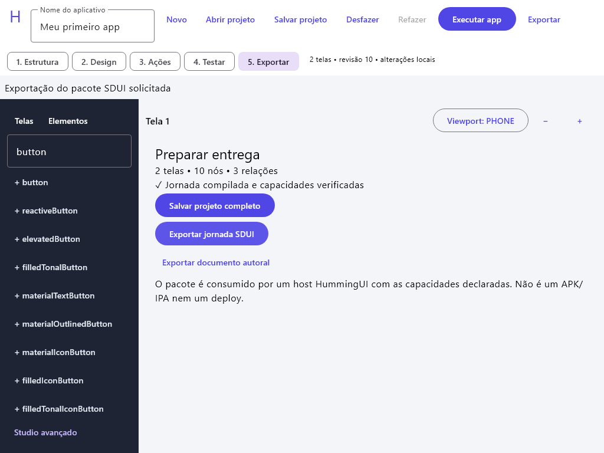

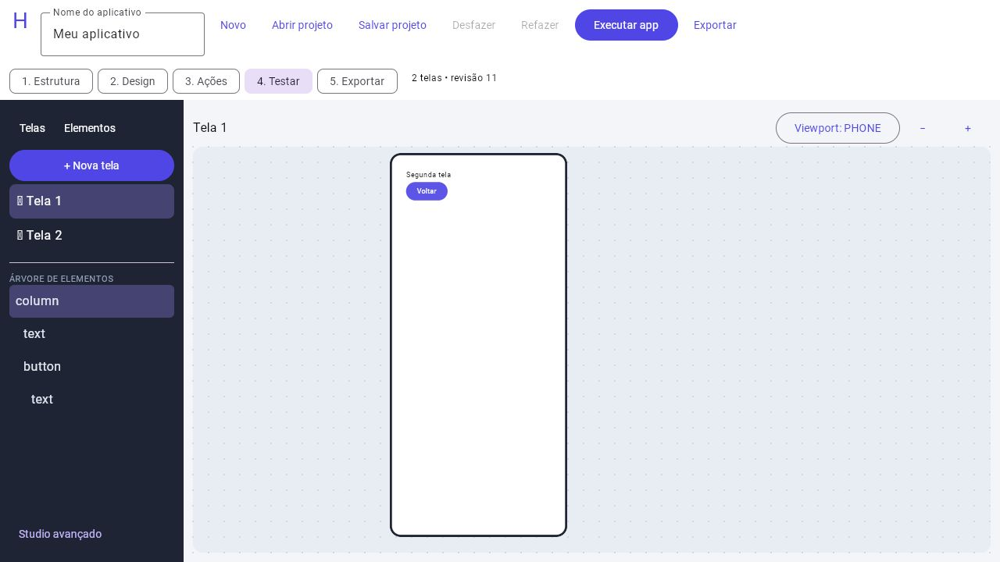

## Prints do catálogo

As primeiras seis capturas são do app executado pelo renderer Compose/JVM, geradas pelos testes de UI e inspecionadas. A última mostra execução real Wasm no navegador. Não são mockups, nem prova de execução Android/Apple. A captura compacta é uma viewport estreita no teste JVM.

### Catálogo e formulário

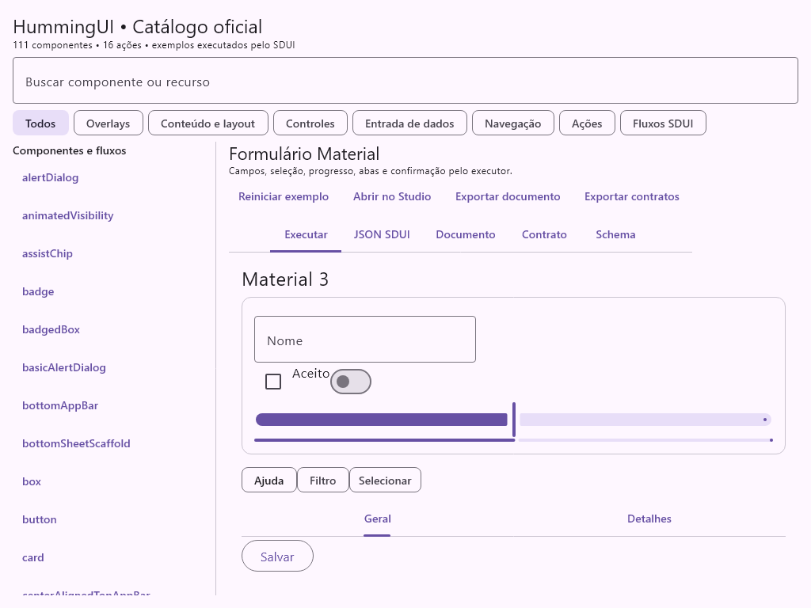

### Componente, estado e evento

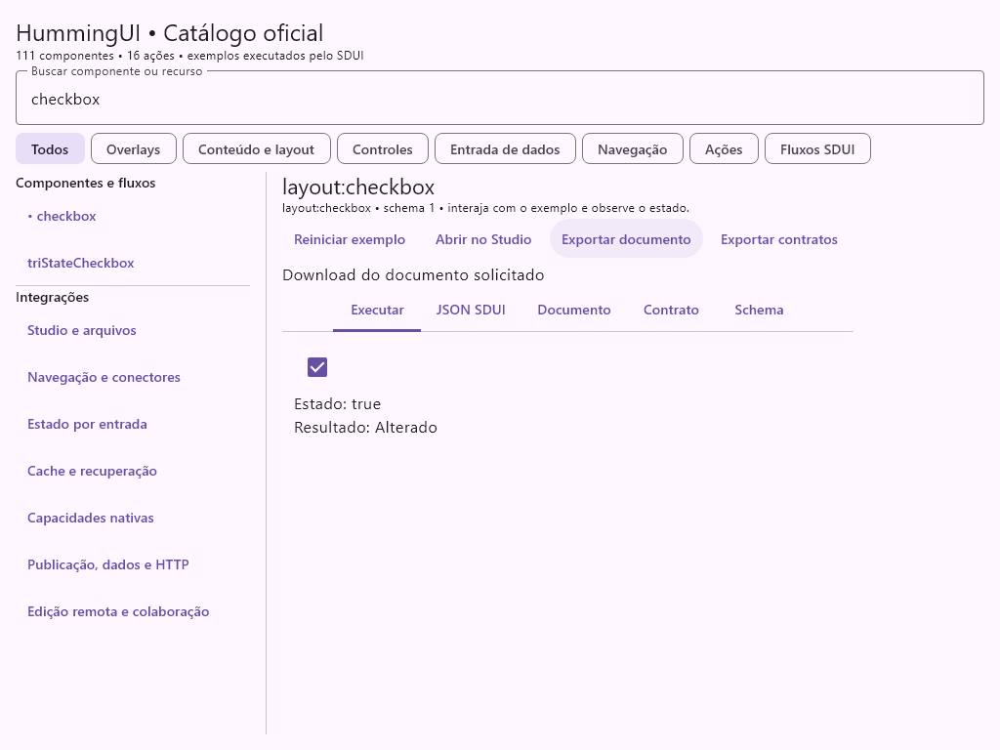

### Fonte do exemplo

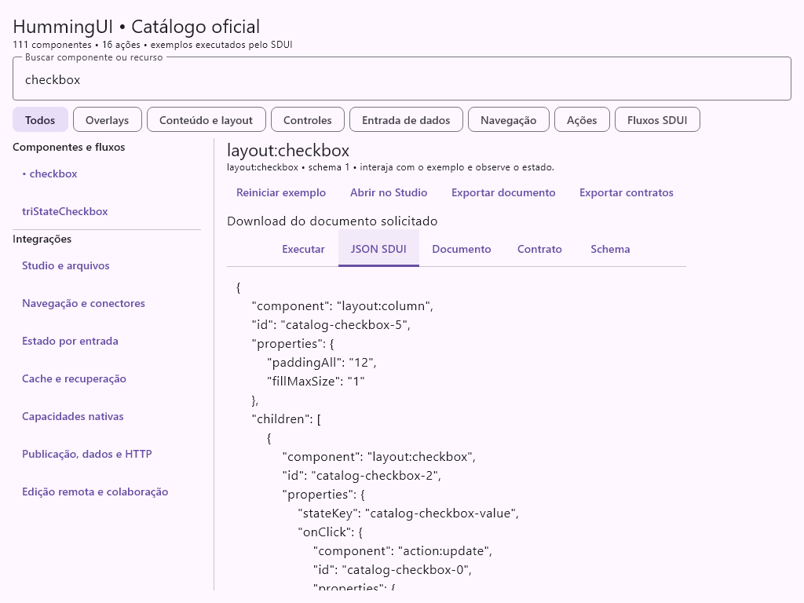

### Mesmo documento no Studio

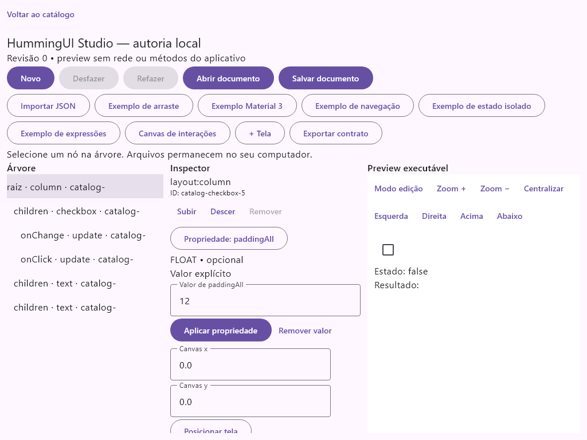

### Layout compacto

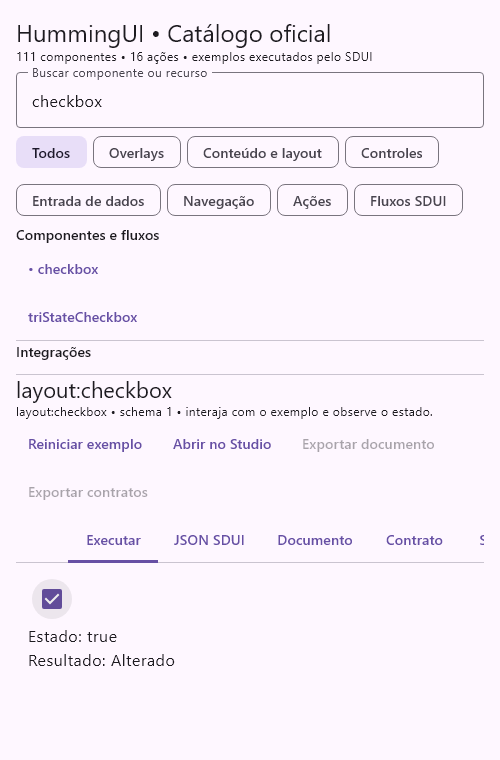

### HTTP, publicação e BFF reais

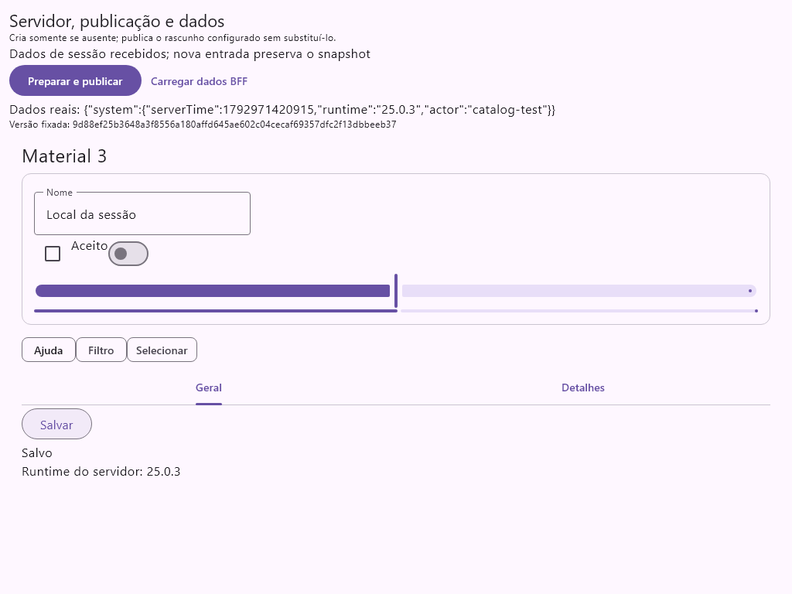

### Catálogo Wasm no navegador

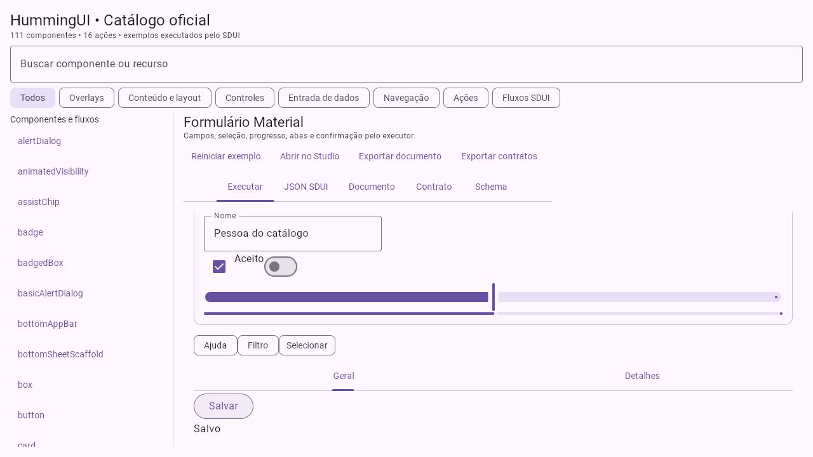

## Como usar o catálogo

1. Busque por nome wire ou recurso e filtre por categoria.
2. Selecione um componente. A fixture inclui os pais/slots exigidos pela API, como abas, segmentados e menu exposto.
3. Interaja em **Executar**. O rodapé mostra estado e resultado dos eventos quando aplicável.
4. Confira **JSON SDUI**, **Documento**, **Contrato** e **Schema**. Código é selecionável.
5. **Reiniciar exemplo** descarta somente a sessão de execução daquele exemplo. Estado do formulário não é gravado dentro do documento autoral.
6. **Abrir no Studio** transfere o documento para o editor; permite alterar propriedades, ordenar, desfazer/refazer e exportar. Sair com alterações pede decisão explícita.
7. **Exportar documento** salva o formato autoral; **Exportar contratos** salva o pacote compilado. São formatos diferentes. No browser, preservar downloads é responsabilidade do usuário; no desktop há seletor de arquivos.

Os nomes wire, limitações de propriedades e compatibilidade dos três botões legados estão no [inventário Material 3](../docs/material3.md). As capturas não substituem a [matriz de qualificação](../docs/current-state.md).

## Rotas e entradas

| Parte | Entrada | O que executa |
| --- | --- | --- |
| Catálogo Wasm | / ou ?catalog | Componentes, ações, fontes, Studio e fluxos locais |
| Studio direto Wasm | ?studio | Editor local sem o shell do catálogo |
| Preview anterior Wasm | ?preview | Fixture local anterior |
| Jornada/cache Wasm | ?journey | Cache e recuperação locais versionados |
| Nativo Wasm | ?native | Capacidade ausente explicitamente; sem uptime inventado |
| Catálogo desktop | run --args=--catalog | Catálogo, arquivos nativos e integrações loopback opt-in |
| Editor remoto desktop | run --args=--remote-studio | Conexão direta com rascunho e recuperação |
| Smoke desktop | run --args=--local-smoke | Formulário local mínimo de caracterização |
| App legado desktop | run sem args | Entrada histórica com recursos; use catálogo/smoke para o recorte local qualificado |
| Android | Intent extra catalog=true | Catálogo com bridge Android real |
| Android nativo | Intent extra nativeExample=true | Uptime e recriação do host |
| JS legado | ?catalog no host JS | Catálogo sem adapter de arquivos; execução não qualificada neste recorte |
| iOS | CatalogViewController() | Entrada do catálogo para conectar ao host Swift/Xcode; exige Mac e qualificação |

O shell do catálogo usa Compose para navegação e inspeção. Os previews usam os componentes/ações SDUI instalados. Partes que dependem de plataforma ou servidor só aparecem conectadas quando o host instala essas capacidades.

## Fluxos locais

- **Formulário Material:** campos, checkbox/switch, chips, slider/progresso, abas e ação Salvar.
- **Expressões e validação:** estado tipado, linguagem limitada, dependências, visibilidade/habilitação, tokens, erro e recuperação.
- **Ações e lifecycle:** onCreate, sequência suspensa, condição e evento. Cada handler também tem exemplo individual na categoria Ações.
- **Arraste e bounds:** abrir no Studio, ativar Modo edição e arrastar A/B entre os containers; guia, revisão, cancelamento e undo usam o modelo existente.
- **Navegação e conectores:** jornada autoral compilada, ida/volta e edição do grafo no Studio.
- **Estado por entrada:** nova visita tem owner próprio; voltar preserva a entrada anterior.
- **Cache e recuperação:** fontes locais registradas, versão/sessão, recarga e falha local solicitada pelo usuário. É demonstração de cache de definições, não um backend simulado.
- **Capacidades nativas:** o Android instala device.uptime real. Desktop/browser sem esse registro retornam NATIVE_UNAVAILABLE.

As ações legadas mantêm o comportamento atual: comparações numéricas recebem **nomes de estados** em param1/param2; isEmpty/isNotEmpty consultam o estado nomeado em param1. not/and/or/xor/equals consultam o estado de destino com os parâmetros como defaults, e equals é booleano. O catálogo não altera essas regras silenciosamente. Para lógica tipada nova, prefira a linguagem de expressões. action:method só invoca métodos previamente registrados; o exemplo usa getPlatformName. Reabrir um documento com métodos em outro host exige as mesmas capacidades declaradas.

## Servidor local e PostgreSQL

O servidor usa HTTP loopback, autorização por documento e PostgreSQL real. O recorte de demonstração não é distribuição pública, TLS ou autenticação de produção. As credenciais ficam no ambiente e nunca nos documentos/exportações.

### 1. Banco local

Instale/inicie Docker Desktop em modo Linux. Estes comandos criam um banco **de demonstração separado**, com volume persistido e porta somente loopback. Escolha uma senha local; não use credenciais de produção.

```powershell
$env:HUMMING_DB_PASSWORD = Read-Host -MaskInput 'Senha do banco local'
$env:POSTGRES_PASSWORD = $env:HUMMING_DB_PASSWORD
$catalogImage = 'postgres@sha256:edb0c08dc33befd0262ab3b5cf1c4f3f8cfd8b09e88c05b45adee29d6761ddb6'
docker volume create humming-catalog-data
docker run -d --name humming-catalog-db --env POSTGRES_PASSWORD --env POSTGRES_USER=humming --env POSTGRES_DB=humming_catalog --publish 127.0.0.1:54329:5432 --mount type=volume,source=humming-catalog-data,target=/var/lib/postgresql $catalogImage
docker exec humming-catalog-db pg_isready -U humming -d humming_catalog
```

Se o container já existe, use docker start humming-catalog-db e confira readiness; não repita docker run com o mesmo nome. O volume conserva o banco. Para parar ao terminar: docker stop humming-catalog-db. Nenhum comando de remoção é necessário.

### 2. Servidor — terminal A

```powershell
$env:HUMMING_DB_URL = 'jdbc:postgresql://127.0.0.1:54329/humming_catalog'
$env:HUMMING_DB_USER = 'humming'
# HUMMING_DB_PASSWORD é a senha definida acima; configure se este for outro terminal.
$env:HUMMING_LOCAL_TOKEN = Read-Host -MaskInput 'Token local de 32 a 256 caracteres imprimíveis'
$env:HUMMING_LOCAL_ACTOR = 'editor-a'
.\gradlew.bat :humming-server-host:runLocal --args=--catalog-demo
```

As migrations executam na inicialização. Copie a **origin/porta realmente impressa**; a porta do servidor HTTP é dinâmica. O principal deste host só concede local/example. --catalog-demo registra o plano catalog-system com relógio, versão JVM e actor reais. Sem a opção, as rotas BFF não recebem uma fonte implícita. Sem PostgreSQL, runLocal é volátil e não oferece edição/publicação/colaboração persistidas.

### 3. Catálogo conectado — terminal B

```powershell
$env:HUMMING_STUDIO_ORIGIN = Read-Host 'Origin impressa pelo servidor, por exemplo http://127.0.0.1:PORTA'
$env:HUMMING_STUDIO_TENANT = 'local'
$env:HUMMING_STUDIO_DOCUMENT = 'example'
$env:HUMMING_STUDIO_TOKEN = Read-Host -MaskInput 'Mesmo token do servidor A'
$env:HUMMING_STUDIO_CONNECTION = 'catalog-local'
$env:HUMMING_STUDIO_CHECKPOINT = Join-Path $env:TEMP 'humming-catalog-editor-a.json'
.\gradlew.bat :sample:composeApp:run --args=--catalog
```

Em **Publicação, dados e HTTP**:

1. Consultar rascunho por HTTP SDUI executa network:request com endpoint registrado e ramos aguardados. Antes de criar o documento, 404 é um resultado de falha real.
2. Preparar e publicar cria o exemplo oficial **somente se o rascunho estiver ausente**. Se já existir, preserva e publica esse documento, sem substituí-lo pela fixture.
3. O cliente lê e fixa a versão publicada, verifica capacidades e monta a definição no renderer.
4. Carregar dados BFF busca o plano registrado da versão fixada e abre uma nova entrada com ScreenInputs.server. O texto SDUI “Runtime do servidor” passa a exibir o dado real.
5. Edite o campo e clique Salvar: estado local não altera o rascunho no banco nem o snapshot publicado. Essa ação de formulário é diferente de sincronizar o documento no Studio remoto.

A sessão catalog-local é atribuída pelo host local de demonstração, sem sessionId vindo do payload. O token não vai para o snapshot. O cliente HTTP pertence ao composition root desktop e é fechado ao sair.

### 4. Editor remoto e colaboração

Após preparar o rascunho, abra **Edição remota e colaboração**. A conexão restaura o checkpoint, mostra revisão confirmada/pendências/pausa e grava recuperação antes de enviar. Edite no Inspector, clique Sincronizar pendências e ative Acompanhar editores. Conflitos conservam a cópia local; Arquivar e usar remoto exige arquivo de recuperação. Undo compensa somente o último envio próprio reconhecido e recusa sobrescrever alterações concorrentes no mesmo item.

Para dois autores reais, inicie outro runLocal com **o mesmo banco**, HUMMING_LOCAL_ACTOR=editor-b e outro token. Ele imprimirá outra porta. Abra outro catálogo desktop apontando à segunda origin/token, com o mesmo tenant/documento e **outro arquivo** de checkpoint. As instâncias compartilham o journal PostgreSQL; a presença distingue actors. Não reutilize um checkpoint entre dois clientes simultâneos. Presença expira após 30s se o cliente sair sem leave. O cliente faz polling opt-in, sem CRDT ou promessa de entrega exatamente uma vez.

## Servir o bundle web sem o dev server

```powershell
.\gradlew.bat :sample:composeApp:wasmJsBrowserDevelopmentExecutableDistribution
python -m http.server 8081 --bind 127.0.0.1 --directory sample/composeApp/build/dist/wasmJs/developmentExecutable
```

Abra http://127.0.0.1:8081/. O servidor estático usa exatamente os arquivos compilados e não acompanha alterações automaticamente; recompile e recarregue após mudar o código. A porta 8081 permite preservar outra instância local já aberta. Encerre com Ctrl+C no terminal desse servidor.

## Android

Descubra a tarefa e monte o APK:

```powershell
.\gradlew.bat :sample:composeApp:tasks --all
.\gradlew.bat :sample:composeApp:assembleDebug
adb devices
adb -s SEU_SERIAL install -r sample/composeApp/build/outputs/apk/debug/composeApp-debug.apk
adb -s SEU_SERIAL shell am start -n sample.app.androidApp/sample.app.AppActivity --ez catalog true
```

Use um emulador/dispositivo disponível, sem presumir serial. O catálogo recebe a bridge Android. Para o exemplo nativo isolado, substitua catalog true por nativeExample true. O transporte/storage remoto concreto continua desktop; o catálogo Android não instala acesso ao banco ou credenciais. A compilação não equivale a teste visual do APK.

## Apple e JS

No Mac, abra sample/iosApp/iosApp.xcodeproj no Xcode. O host Swift atual chama MainKt.MainViewController(); para o catálogo, conecte MainKt.CatalogViewController(). Se usar CLI, descubra schemes/destinos com xcodebuild -list antes de escolher um. Não há qualificação Apple neste ambiente Windows.

O source set JS preserva o App legado e oferece ?catalog sem adapter de arquivos. O fluxo web recomendado e qualificado por compilação é Wasm. Não equipare compileKotlinJs a execução JS no navegador.

## Testes, auditoria e geração de prints

```powershell
.\gradlew.bat :humming-contract:jvmTest :humming-studio-model:jvmTest :sample:composeApp:jvmTest
.\gradlew.bat :sample:composeApp:jvmTest --tests sample.app.OfficialCatalogTest
.\gradlew.bat :sample:composeApp:compileKotlinWasmJs :sample:composeApp:compileDebugKotlinAndroid
.\scripts\verify-postgres.ps1 -PublishedClient
```

O último comando usa Docker, cria fixture isolada, executa PostgreSQL/HTTP/Compose, reinicia o banco e repete. Não usa um fake no lugar da integração. Conserva o container/volume parado como evidência; não faz prune. Os logs em build são ignorados pelo Git e não devem imprimir credenciais.

OfficialCatalogTest valida cobertura dos schemas, compila e monta cada exemplo, testa interação/exportação/Studio e gera capturas em sample/composeApp/build/reports/official-catalog. PublishedClientIntegrationTest gera catalog-services.png com servidor e banco reais. Após validar/inspecionar as imagens, copie-as sem edição para sample/docs/images para atualizar este README.

A auditoria de famílias Material é scripts/audit-material3.py: recebe o sources.jar da **versão realmente resolvida**, sem baixar outra release. Consulte [Material 3](../docs/material3.md) para o procedimento completo.

## Onde fica cada parte

| Módulo / arquivo | Responsabilidade |
| --- | --- |
| humming-contract | Wire, schemas, diagnósticos, valores/expressões e catálogo puro |
| humming-core | Registro de bibliotecas/providers, owners, bindings e executor |
| humming-layout-material3 | Renderers Material, geometria observada, assets registrados e tema |
| humming-actions | Handlers de ação e métodos registrados |
| humming-navigation | Graph, entradas isoladas e cache de definições |
| humming-network | network:request e transporte injetado pelo host |
| humming-studio-model | Documento, índices, comandos, undo, geometria, compilador, publicação e outbox puros |
| humming-server-application | Autorização e casos de uso de rascunho/publicação/dados |
| humming-server-postgres | Migrations, revisões/CAS, recibos, journal e snapshots |
| humming-server-host | HTTP loopback e composition root de servidor |
| composeApp/.../OfficialCatalog.kt | Inventário e fixtures determinísticas de componentes |
| composeApp/.../CatalogActionExamples.kt | Exemplos individuais dos handlers de ação |
| composeApp/.../OfficialCatalogApp.kt | Busca, filtros, fontes, exportação, preview e passagem ao Studio |
| composeApp/.../CatalogServices.kt | Percurso HTTP/publicação/BFF e renderer da versão fixada |
| composeApp/.../DesktopCatalog.kt | Arquivos/HTTP desktop e configuração do ambiente |

O ponto de retomada e as evidências atuais ficam exclusivamente em [estado atual](../docs/current-state.md). Este README ensina a executar e usar o app; não mantém um segundo status de desenvolvimento. Não há deploy automático, push ou distribuição implícita nestes comandos.
